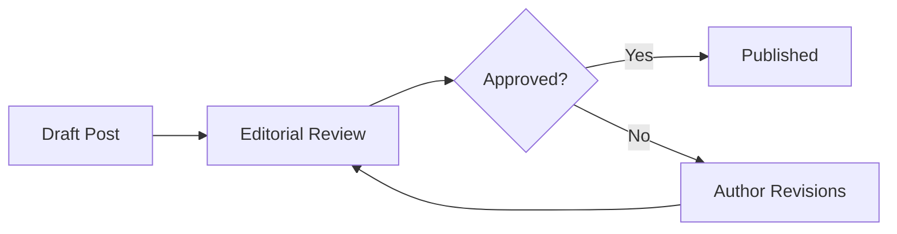

# Accessibility & Screen Reader Fallbacks

Visual diagrams are often completely inaccessible to screen readers and text-only browsers.

By using `strategy: 'both'`, our MDX plugin automatically pairs the static SVG with a collapsible `
` text diagram:

Click the "Text version" dropdown below the diagram to inspect the plain-text box-drawing alternative.
