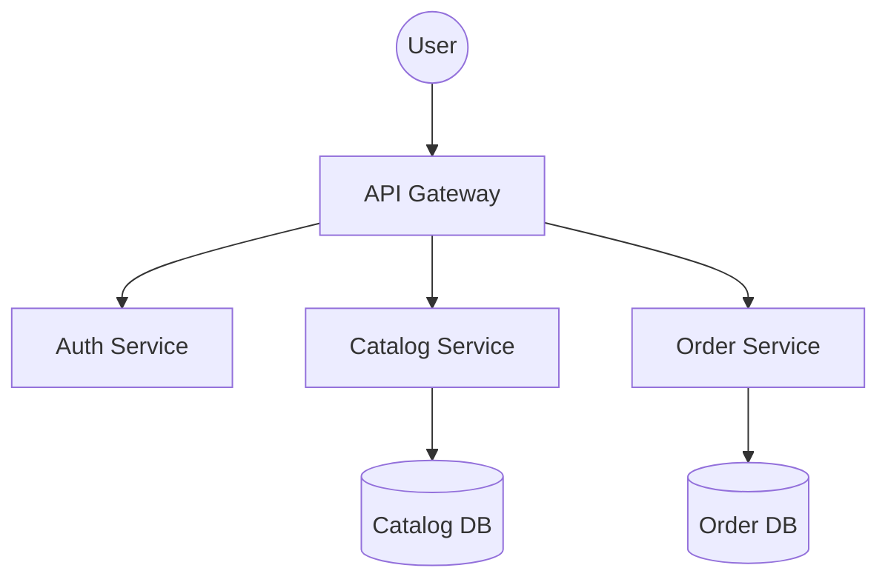

# System Architecture

This page demonstrates multi-node flowcharts with vertical orientation (TD) styled according to design system tokens.

Notice how borders, fonts, surfaces, and accent lines adapt seamlessly to dark mode toggling.
