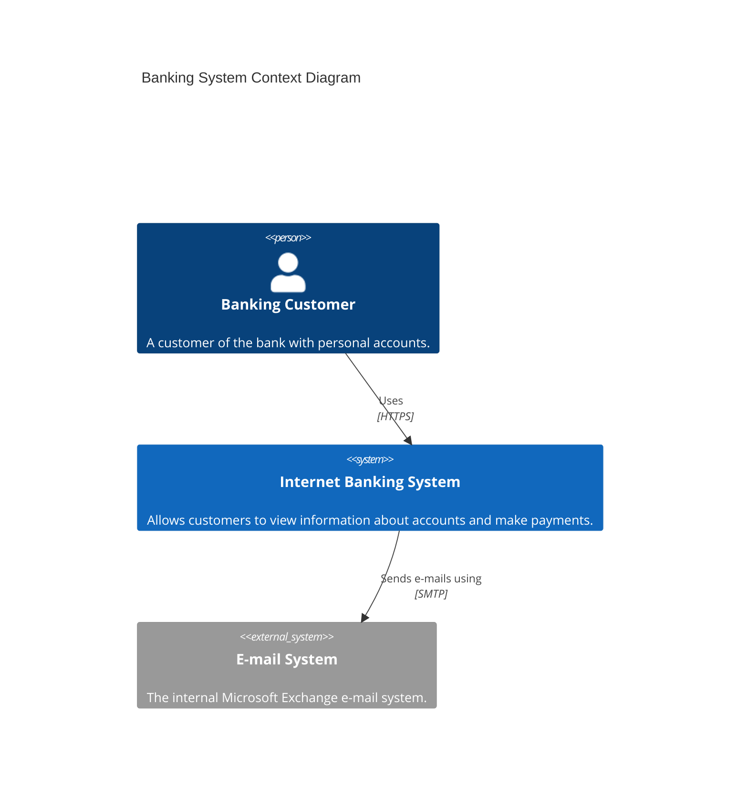
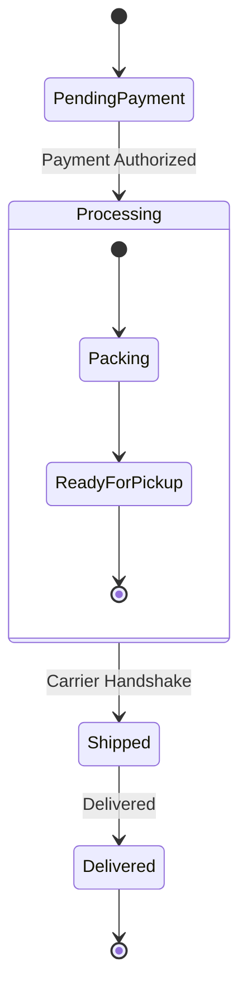
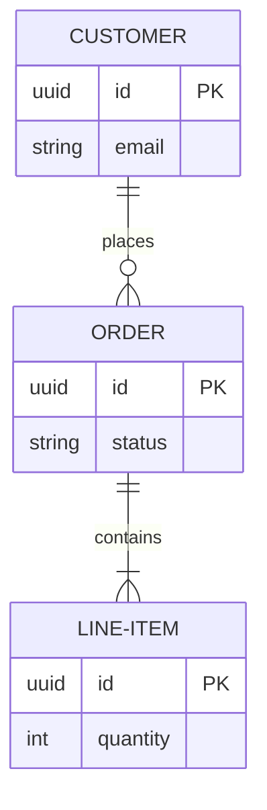
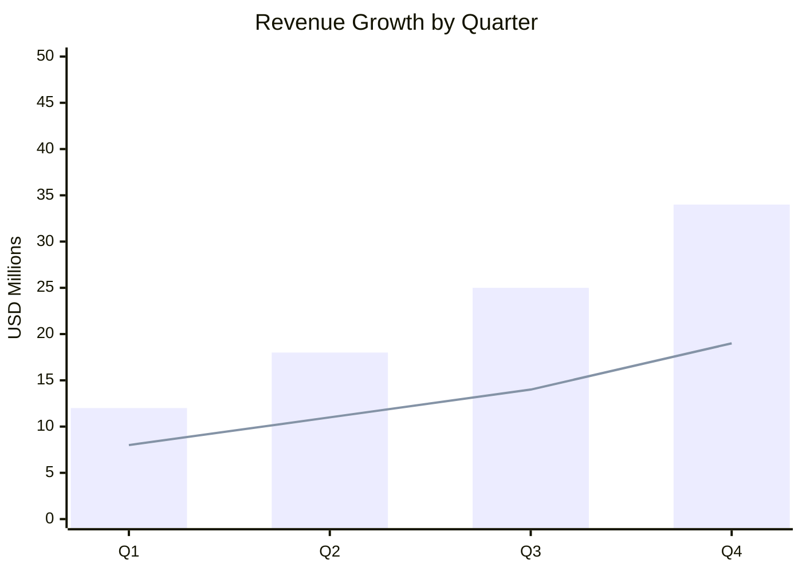
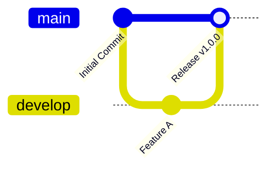

# Foundational Fixtures Gallery

This gallery compiles foundational Mermaid diagram types using `@rtkelly-labs/mermaid-toolkit` with static Pele SVG compilation and accessible ASCII fallbacks.

## 1. Structural: C4 Architecture

## 2. Behavioral: State Lifecycle

## 3. Schema & Knowledge: Entity-Relationship

## 4. Visual Analytics: Quarterly Revenue (XYChart)

## 5. Developer Tooling: Git Graph

