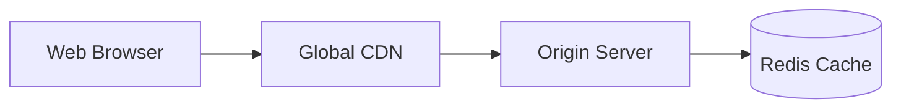

# Design System Showcase

Welcome to the `@rtkelly-labs/mermaid-toolkit` integration test site.

This site exercises static SVG compilation via Pele, native CSS variable theming, and accessible ASCII fallbacks.

## Quick Example

The diagram above is rendered into static SVG at build time with **0 KB client-side JavaScript**.
